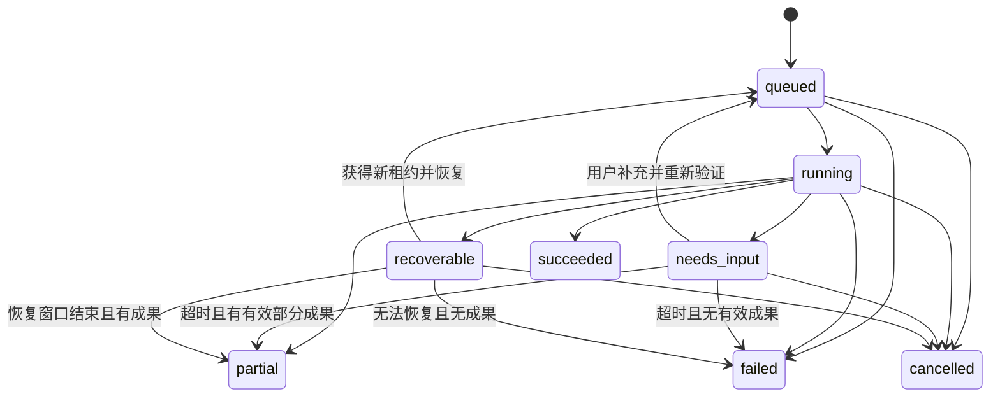

# ScholarMind 优化 PRD v1.0

**用途：后续 coding agent 的产品与工程实施基线。**

| 项目 | 内容 |
|---|---|
| 编制日期 | 2026-11-19，Asia/Shanghai |
| 状态 | 需求与默认方案已定义，尚未实施；各发布阶段必须独立验收 |
| 现状基线 | HEAD `92bfb4f` 与编制时工作区已有改动；实施前重新检查差异，不得覆盖用户改动 |
| 问题依据 | [28 项产品与技术诊断](C:/Users/13067/Desktop/全能研究Agent/docs/reports/PRODUCT_AUDIT_2026-11-19.md) |
| 配套实施文件 | [Coding Agent 实施手册](C:/Users/13067/Desktop/全能研究Agent/docs/prd/ScholarMind_Coding_Agent_Playbook_v1.0.md) |
| 配套验收文件 | [验收与问题追踪矩阵](C:/Users/13067/Desktop/全能研究Agent/docs/prd/ScholarMind_Acceptance_Matrix_v1.0.md) |
| 指标说明 | 文中的指标、容量和预算是开发默认值或验收目标，均不是已达到的实测结果 |

阅读顺序：本 PRD → 实施手册 → 验收矩阵 → 当前代码。产品行为和接口契约以本 PRD 为准；任务顺序以实施手册为准；完成证据以验收矩阵为准。发现代码与文档不符时记录差异，不能据现有错误行为修改验收目标。

## 1. 产品决策与首期边界

### 1.1 产品目标

帮助新闻传播及相近社会科学领域、已有论文初稿的研究者，完成一次**能定位原文、说明依据、控制修改并导出版本的投稿前诊断与定向修改**。

主流程为：上传论文 → 确认阅读范围 → 全文文本诊断 → 查看问题与依据 → 选择修改目标 → 审阅修改对照 → 逐项采纳 → 导出稿件与修改说明。

首期价值判断围绕用户是否得到有效诊断、是否采用修改、是否减少人工整理工作。Agent 数量、内部评分增长、调用次数和界面动画不作为产品成果指标。

### 1.2 工程默认决策

| 决策 | 默认方案 | 对实施的约束 |
|---|---|---|
| D-01 用户范围 | 新闻传播及相近社科、有初稿的个人研究者 | 首期不承诺全学科或顶刊发表；其他学科如保留入口须显示支持边界 |
| D-02 用户入口 | 一个主助手、一个项目工作区 | 后台保留必要角色，用户无需承担角色交接 |
| D-03 首期强任务 | `review` 与 `revision` | 文献检索作为支撑能力；从材料辅助起草作为兼容能力，不作为首期主卖点 |
| D-04 前端目标 | 复用现有 Vite + 模块化 JavaScript 前端 | 当前源码并非 React 组件体系，不为本项目额外重写框架；R0 仍须修复实际交付的单 HTML |
| D-05 服务端状态 | 现有 SQLAlchemy ORM 数据库为事实来源 | Redis/Chroma/浏览器缓存都不能成为项目、任务、权益或成果的唯一副本 |
| D-06 异步执行 | 复用 `scheduler` 中现有 Celery 实例；本地可用同契约的轻量执行器 | 不新建第三套队列；队列采用至少一次投递，副作用通过幂等和租约控制 |
| D-07 检索 | 保留现有 Chroma 与搜索适配器 | 私有全文和公共元数据必须分区、标明来源粒度；不在本轮更换整套检索技术 |
| D-08 质量结论 | 输出问题、依据、覆盖范围和局限 | 模型分数不能替代事实验证，也不能生成“已达发表水平”的保证 |
| D-09 商业兼容 | 保留既有商品、订单和已购买权益 | 本 PRD 不授权实施 agent 修改价格、迁移扣费用途、补发付费权益或发布上线 |
| D-10 扩展策略 | 先修复、验证，再开放 | 自定义 Agent、任意浏览器执行、普通用户代码运行、技能市场暂不扩展 |

用户后续调整上述产品方向时更新本表及关联任务。无需因采用这些默认工程方案而中断普通文档准备或只读核查。

### 1.3 首期支持与暂缓范围

| 能力 | 首期要求 | 暂缓部分 |
|---|---|---|
| 投稿前诊断 | 全文文本与可解析表格、问题定位、方法与论证风险、引用核查清单 | 复现实验、重跑统计模型、直接判定发表结果 |
| 定向修改 | 依据用户选定问题提出补丁，保留受保护事实，逐项采纳 | 自动整篇重写、用户未确认即覆盖正文 |
| 文献 | 可核实元数据、可用原文片段、支持关系与不确定性 | 以搜索元数据冒充已读全文；自动绕过文献访问限制 |
| 文件 | 文本型 PDF、DOCX、TXT、Markdown | OCR、扫描件全文理解、复杂公式和图像的自动学术验证 |
| 导出 | Markdown、DOCX、诊断报告、修改说明 | 未验证的期刊排版合规保证、自动投稿、PDF 高保真排版 |
| 图表 | R0 关闭未接通入口；R2 通过数据真实性验收后开放 | 用示例数据替代用户研究数据 |
| 代码 | 允许真实可用的代码生成/下载，保留管理员执行限制 | 面向普通用户开放现有进程执行接口 |
| 起草 | 修复已有提纲与字数传递；来源不足时仅输出明确标记的草稿/待研究项 | 无数据却输出完成实证研究的论断 |

## 2. 用户场景与成功定义

### 2.1 核心场景

| 场景 | 用户输入 | 应交付成果 | 不足时的行为 |
|---|---|---|---|
| S-01 初稿投稿前诊断 | 论文初稿、可选投稿目标 | 问题优先级列表、原文位置、判断依据、全文文本覆盖报告 | 文件不可读则说明原因并要求补充，不生成虚构评审 |
| S-02 按审稿意见修改 | 原稿、审稿意见、用户选择的修改范围 | 对照修改建议、未解决事项、修改说明 | 需新数据/新实验时记录待办，不能编造结果 |
| S-03 论证与引文核查 | 论文、用户提供的参考文献或可检索来源 | 缺失证据、错配引用、来源核实状态 | 没有全文时明确只核查元数据/摘要 |
| S-04 继续上次任务 | 已有项目和任务 | 恢复材料、已完成步骤、未完成事项及对应版本 | 无检查点则从安全边界重试，不假称已断点续跑 |
| S-05 局部润色 | 用户选定段落与目标 | 保留事实的文字补丁和修改原因 | 不因出现“论文”一词而启动检索 |

### 2.2 成功与质量分开记录

一个诊断任务可以成功指出论文有严重问题。一个修改任务只有提出了有效、可定位、可审阅的建议才算完成；用户尚未采纳不等于技术失败。质量结论不得直接由任务状态推断。

诊断质量结论 `quality_verdict` 仅取：

- `issues_found`：发现有依据的问题。
- `no_major_issues_found`：在已声明范围内未发现主要问题，不代表保证正确或可发表。
- `insufficient_evidence`：材料不足以支持所请求的判断，报告必须列出缺失项。

禁止用固定 85 分、缺失评分默认值、达最大轮数或“没有抛异常”作为成功依据。

## 3. 版本与交付门槛

| 阶段 | 目的 | 必须完成 | 放行条件 |
|---|---|---|---|
| R0 交付修复版 | 停止错误承诺与失败扣额，修复现有关键链路 | 路由、Skill、上传隔离、执行器身份、输入输出协议、工具回传、失败状态、权益一致性；不支持能力明确关闭 | 验收矩阵所有 R0 用例通过；现有权限/支付测试无回归；主界面真实操作走通 |
| R1 核心任务版 | 单项目内完成诊断—修改—导出 | 项目/版本/证据、全文文本覆盖、持久任务、补丁采纳、唯一工作区、迁移与回退 | R1 自动化门槛全部通过，至少一组授权论文完成受控人工验收；新旧入口兼容验证 |
| R2 质量验证版 | 证明质量与效率，按需开放扩展 | 人工盲评、真实使用反馈、成本基线；图表等独立能力按各自门槛开启 | 明确质量报告与限制；新增节点有增益证据；不以 UI 模拟评分代替真实用户结果 |

R0 不要求一次性完成所有新架构。可以先关闭不可靠入口，但必须保留用户资料和已购买权益，显示明确的不可用原因，不再返回假成功。阶段内的受控预览可独立验证，不能绕过数据隔离与扣额门槛。

## 4. 信息架构与交互规范

### 4.1 唯一工作区

工作区由项目导航、文档与修改区、主助手/任务区构成；窄屏以标签切换，不能让用户在多个互不关联的“工作台”之间复制材料。

- 项目导航展示真实项目、文件数、任务与版本，计数来自服务端。
- 文档区支持章节导航、问题锚点、修改前后对照、逐项接受/拒绝、版本切换。
- 助手区接收自然语言，显示当前目标、材料、任务步骤、待补充信息和成果入口。
- “全文文本已读”“仅检查摘要”“有未解析页面”等必须来自实际覆盖记录。
- 初次进入可直接上传或选择明确标注的授权样例；不自动叠加导览和登录浮层。
- 上传与私有资料访问必须登录。样例展示不得伪装成用户的真实任务成果。

### 4.2 输入与追问

必要输入只有论文和本轮目标；投稿期刊、研究类型和方法可从材料识别，低置信度时提示用户纠正。通常只提出 0—2 个影响结果的追问；文件不可读等阻断事项不受该数量约束，但必须说明原因。

明确操作可确定性路由；含糊操作由结构化意图分类处理。分类结果必须包含 `intent`、`confidence`、`document_version_id`、`required_inputs`。有实际支持输入后才能执行，不使用关键词命中代替用户授权。不能仅因出现“论文”“文献”而改变任务。

复合任务必须有有序步骤，例如“检索 10 篇并写综述”先检索、筛选与核查可用信息，再依据结果写作，并在范围不足时披露；不能只返回检索卡片后结束。

### 4.3 空、错、慢与完成

空结果显示实际空结果与可选下一步；故障显示原因、保留成果和重试方式。加载状态显示阶段和已完成单元，不能根据输出字符数制造任务百分比。只有全部确定工作单元可计数时才显示比例，否则显示阶段进度。

完成页至少显示成果、处理范围、重要问题、未解决项、所用资料版本和导出入口。内部角色、token 和技术日志置于可展开详情；用户默认看到研究进展。

## 5. 功能需求

### FR-01 产品范围与真实能力展示

P0/R0。能力列表由服务端返回当前用户的可用性与状态，状态为 `ready/degraded/disabled/unauthorized/unknown`，包含 `checked_at`、原因和支持粒度。来源可查询不等于有全文权限，必须分别展示。移除“杜绝幻觉”“达到顶刊发表水平”等无验证承诺。

失败和缺少数据不得展示虚构论文、引用量、项目数量或连接状态。R0 未接通的自定义 Agent、Skill 写操作、图表和 Browser Agent 正式入口关闭或明确显示不可用；不得仅弹“已保存”。代码执行保持默认关闭和管理员限制。

### FR-02 单一任务接收与正确路由

P0/R0，R1 接入统一工作区。对话、按钮和上传入口创建同一任务对象，避免同义任务走不同实现。保留局部润色、架构审查与检索等语义区别；任务传递原始用户指令与结构化目标，输入规范见第 8 节。

任务开始前显示材料、处理范围与权益；用户请求本身明确时无需重复确认。诊断可以直接运行；任何正文写入均通过 FR-08 的采纳动作完成。

### FR-03 项目、文件和所有权

P0/R0 隔离，R1 完整项目模型。

- 用户身份只来自服务端认证。请求传入 `user_id/owner_id` 不产生授权效力。
- 每个文件、版本、任务、事件、证据、补丁、图表和导出都归属于一个用户；研究资产同时关联项目。
- 同一用户不同项目的资料也只在显式关联后共享；检索不得默认跨项目。
- 未授权对象统一返回 404；列表、搜索、流式事件和下载同样检查所有权。
- 单文件限制 20 MiB；应用与代理的 multipart 请求上限至少允许 22 MiB，避免传输层提前截断合法文件。
- R1 默认每项目 50 个活动文件、每用户 1 GiB 已存储内容，可由服务端配置；容量按所属用户/项目计算。R0 可保留现有每会话上限，但绝不能跨用户共享计数。
- 允许同一所有者内按内容哈希复用存储，但项目关联、来源与权限独立；不向其他用户泄露哈希命中情况。
- 文件名用于展示，物理路径由服务端生成，不接受客户端文件系统路径。
- 删除后立即撤销检索与下载，并取消/失效依赖该文档的活动任务；旧事件不得继续泄露删除内容。实际文件和索引清理必须有可重试记录。

### FR-04 结构化解析与全文覆盖

P0/R0 披露截断，R1 完整实现。

支持不超过 200 页、200000 个解析后 Unicode 码点的文本型论文；超出范围明确拒绝或让用户选择范围，禁止静默截断。DOCX 正文段落、表格和脚注应按来源位置提取；PDF 保留页码；TXT/Markdown 保留段落与标题路径。解析结果可回看，用户可以纠正明显错误并生成新版本。

解析质量与分析覆盖是两项独立数据：

1. `parse_status = complete/partial/unsupported/failed`，附页数、无文本页、未支持对象和错误。扫描件、加密不可读文件和丢失必要表格不能显示为完整解析。
2. `analysis_coverage = analyzed_eligible_blocks / expected_eligible_blocks`。每个分析单元记录输入版本、块集合、处理结果与哈希；全文文本诊断要求该比例为 1。

图像、复杂公式与统计复现实验不在首期完整分析承诺内，界面必须明确“全文文本与可解析表格”，同时列出未分析对象。不能通过缩小分母把丢失页面算作全文已读。解析部分成功时，仅可提供明确限定范围的 partial 结果或请求补充。

### FR-05 私有全文检索与项目记忆

P1/R1。私有文档以结构块构建 chunk，携带用户、项目、文档版本、块、页码/段落、来源和内容哈希。建议按标题与段落切分，初始目标 800—1200 Unicode 码点、重叠不超过 100；实际边界不得破坏表格/引用锚点，token 预算以模型配置为准。

检索必须先限定授权范围，结果再次按数据库所有权校验。向量服务不可用时可退回同一授权范围内的词法搜索，并显示降级；不能退回全局无过滤搜索。重建索引要使用新索引版本，构建完成后切换，不能先清空可用索引。删除和版本失效需要同步影响检索。

全文诊断必须遍历所请求范围的全部块，不能用 top-k 检索代替阅读全文。RAG 用于定位补充依据。项目记忆保存用户确认的目标、禁改项、已确认事实和未解决问题，带来源与版本；从聊天推测的内容不能自动升级为已确认事实。

### FR-06 学术搜索与证据分级

P0/R0 取消模拟回退，R1 实现证据模型。

来源记录保存标题、作者、年份、来源平台、DOI/稳定 URL、获取时间、原始响应标识及权限粒度。分开记录：

| 字段 | 枚举 | 含义 |
|---|---|---|
| `metadata_status` | `resolved/unresolved/user_supplied` | 出处是否已核对；用户给出的条目不自动算已验证 |
| `material_level` | `metadata/abstract/full_text` | 实际取得的材料范围 |
| `support_status` | `supported/contradicted/insufficient/unassessed` | 已有材料与具体论断的支持关系 |
| `verification_method` | `tool/model/human/none` | 核查方式；模型判断与人工确认必须区分 |

有 DOI 不等于论断已验证，有摘要不等于已读全文。助手新增引用必须绑定真实可访问记录，无法核实时列入未核实项；禁止生成占位作者、虚构 DOI 或编造引用量。用户已有疑似错误引用应原样保留在稿件中并提出问题，未经采纳不得偷偷替换。

外部来源解析只允许经配置的可信检索/解析器和安全 HTTP(S) 地址，阻断本机、私网和云元数据地址；上传材料中的指令只作为研究内容，不能改变工具权限、用户身份和系统约束。

### FR-07 有依据的诊断报告

P1/R1。按论证、理论/方法适配、证据与引用、表达、格式分别形成诊断，优先给出最多 5 项最有影响的问题，其余可展开。

每个 `Finding` 必须包含：稳定 ID、类别、严重度 `critical/major/minor`、明确问题、原因、建议、依据类型、定位、所需用户动作和核查状态。局部问题必须有版本内定位和原文引用；“缺少某章节”等整体问题使用 `scope=document` 并给出检查过的章节集合，不能捏造不存在的原文位置。

不能声称执行了未运行的统计检验、实验复现或事实调查。对缺少数据的研究，只能指出缺失条件和可执行的研究建议。报告必须区分原文事实、外部来源和模型推断，并给出未解决项。

### FR-08 定向修改与可控采纳

P1/R1。修改任务固定基准版本、选定问题、修改范围和受保护信息。默认保护数字、日期、人名/专名、直接引语、引文及已有研究结论，不自动添加实证结果。修改范围外的块不得更改。

模型输出 `RevisionProposal` 与补丁集合，每项补丁包含原文位置、原文哈希、建议文本、对应问题和原因。先验证再展示，用户逐项或批量采纳后才创建新文档版本。批量采纳也必须是用户明确动作。

应用时检查当前版本与原文哈希；不符返回 409 `VERSION_CONFLICT`，不得模糊覆盖。补丁位置统一用规范化文本中的 Unicode 码点偏移，前端必须处理 JavaScript UTF-16 与该偏移的转换。每次采纳带幂等键和预期版本，重复请求不生成重复版本。拒绝保留原因，撤回生成一个新版本而非修改历史。

### FR-09 可持久使用的成果与导出

P1/R1，R0 先保证已有结果不丢失。所有成果持久关联任务、项目和输入版本，包含类型、内容哈希、生成记录、验证状态和受控下载入口。至少交付诊断报告、修改建议、采纳后的稿件与修改说明。

Markdown/DOCX 导出必须基于用户选定的已存储版本，不能使用浏览器未保存的另一份正文。DOCX 需验证可重新打开，标题、段落、表格、引用标记和已有脚注无静默丢失。只展示实际通过验收的格式；未知 `journal_style` 返回 422，禁止默默套用通用格式并声称期刊合规。

不因会员到期删除既有成果或拒绝用户读取已生成成果；新付费计算仍按权益规则执行。partial 成果允许用户显式导出，文件名和独立说明标明处理范围，不擅自给论文正文加结论性质量保证。

### FR-10 执行器身份、输入与输出契约

P0/R0。generation 和 review 使用独立 Python 包命名空间，例如 `src.backend.research.pipelines.generation` 和 `.review`。代码不能通过改写全局 `sys.path/sys.modules` 选择技能；模型客户端由实例显式注入，不使用可跨任务改写的全局 bridge。

技能的说明、脚本与辅助材料若参与执行，必须显式加载并记录版本，不假设 IDE 中的 AI 会在后台补做。生成、审稿调用各自通过薄适配器进入统一结果协议。

用户选择的提纲必须解析为受授权的 `document_version_id`，内容和结构进入任务；`target_word_count`、研究类型、禁改项与用户指令必须可在运行快照中追踪。字数按可见正文的汉字/中文字符与英文词分别统计并记录采用的计数器版本；输出范围默认目标 ±10%，用户选择的目标在预算不足时不可被静默忽略。

不把“整篇全文、默认 4096 tokens”作为所有节点通用处理方法。按章节或补丁处理，输出长度截断是显式结果状态。评分和返回字段必须严格校验，禁止靠多个猜测字段兜底把错误掩盖成成功。

### FR-11 持久任务、事件与恢复

P0/R0 先持久登记与结果回传，R1 达成完整恢复。

数据库任务、权益预留和待投递 outbox 在同一事务创建，提交后才派发。任务执行前取得租约与递增 attempt/fencing 标识；续租失败、取消或输入失效后，旧执行器不能写回状态、覆盖成果或结算。

已完成的解析、分析单元和成果检查点可复用；恢复须校验输入版本、执行器/提示词版本与模型策略。不能可靠复用时从安全边界重试并告知用户。Redis 中断时保留数据库待执行任务并报告降级，不静默改用不可恢复的内存任务。

受理前已知 broker 不可用时返回 503 且不预留额度；数据库事务提交后才发生断连时保留 queued/outbox，排队超过 300 秒则结束并释放。自动基础设施恢复最多 3 个 attempt，且不重置任务或 billing_group 的累计预算；恢复窗口结束按有效部分成果决定 partial/failed。

事件持久记录序号，支持断线重放。工具成功产生的文件和证据必须先持久化，再发布成果事件；不能在 `done` 后启动无人接收的后台工作。用户离开页面不取消任务，取消必须通过显式接口。

### FR-12 Skill 与配置的真实生效

P0/R0 修复选择与假成功，R2 扩展管理功能。

顶层 `skill_ids` 是唯一规范字段，最多 8 项。兼容期：只有顶层未提供时才读取旧 `context.selected_skill_ids`；显式空列表表示不选；两个字段同时提供且不同返回 422 `SKILL_SELECTION_CONFLICT`。未知/禁用/无权限 Skill 在扣额前拒绝。

任务保存实际应用的规则 ID、版本/哈希与工具许可。`skills_used` 仅表示规则确实注入或工具确实执行，关键词命中不能计为已用。Skill 分为提示规则、工具和工作流；没有相应执行器的文档不能标为可执行技能。配置编辑要么真实保存并作用于后续任务，要么不提供入口。

### FR-13 图表、代码与浏览器能力收敛

P0/R0 能力关闭与真实披露，R2 图表独立放行。

R0 未注册的图表生成接口及生成示例数据路径必须禁用；可以在受控条件下修复真实接口，但不能绕过此处验收。R2 图表任务只接收项目数据文档版本、列映射、图表类型与实际数据范围，保存清洗步骤、过滤/缺失值规则和数据摘要，图中数值可核对。演示模式必须独立标识，不能混入用户项目。

图表下载经所有权校验，不返回服务器绝对路径。普通用户代码执行和 Browser Agent 正式能力不在首期范围；不能为兑现界面按钮而降低现有权限、扩大本机访问或开放任意 Shell。

R2 数据图表的首批输入格式限定为 CSV、JSON 表格与 XLSX（不含宏），沿用文件大小和所有权规则；服务端保存受验证的行列结构及列类型，不把文件名当作数据。支持的图表类型由实际注册并通过数值验收的绘图器返回，不能因类型名称存在就全部显示可用。

### FR-14 权益、模型与结算

P0/R0。现有四项商品的 ID、金额、适用能力和已发放额度保留；商品介绍从现有服务端目录渲染。模型策略在接收任务时解析，保存实际模型、套餐快照、预算、配置版本，所有节点和后续安全恢复使用该快照，不被全局默认模型替换。会员在任务接收后到期，不得导致执行中途静默降档；新任务重新检查权益。

额度采用 `reserved/settled/released` 账本：

| 事件 | 额度行为 |
|---|---|
| 请求无效、无权限、能力不可用 | 不创建预留、不扣额 |
| 请求受理 | 原子预留；额度不足返回 402，不能先跑模型再报错 |
| `succeeded` 且成果通过结构与交付检查 | 恰好结算一次；发现论文质量差并不影响有效诊断的结算 |
| `failed/partial/cancelled` | 默认释放全部本次额度；partial 成果可保留；不自动退现金 |
| `needs_input/recoverable` | 暂不结算，最长持有 24 小时，超时释放并转 partial 或 failed |
| 平台故障重试 | 新 attempt，沿同一 `billing_group_id`，最多一次最终结算；原预留已释放时以原子方式重新预留，不能同时重复持有 |
| 用户改变输入或目标 | 新任务与新幂等键，受理前展示范围；不能伪装成免费无限重试 |
| 重复回调/重复投递/重复点击 | 返回既有操作结果，不重复发放、预留、结算或生成版本 |

新任务的既有权益映射固定为：review→external_review，revision→modification，draft_from_outline→generation；兼容接口原先已明确指定的 capability 按原 SKU 规则校验。literature_review 作为一次用户研究对话受理，按现有对话额度预留一次，不按内部节点重复扣额；chart 在 R2 开放时仅对当前有效的全功能会员开放，不能消耗用户的单次论文生成额度；export 和既有成果读取不额外消耗研究额度。任何新的收费方式另行定义，实施 agent 不得自行用相近额度替代。

同一 billing_group 同时最多有一个活动任务和一个有效预留。平台故障重试共享该组累计预算，不能通过新 task_id 清零消耗。原任务接收后 24 小时内，故障恢复保留已接受模型策略；超过该窗口的手动重试重新验证当前权益，原档位无权使用时明确拒绝并允许用户另建合法任务，不静默降档。

正常聊天保留现有免费次数策略；系统生成的本地问候不消耗研究对话额度，不能用任意客户端 `greeting=true` 绕过收费。模型失败与离线引导不能按有效模型回答结算。

R1 可增加“一次完整诊断试用”的实验能力，但 `ENABLE_REVIEW_TRIAL=false` 为默认；不在本轮自动改变商业权益。授权样例可先用于完整体验展示。

### FR-15 结果诚信、评分与失败处理

P0/R0。模型、工具与解析的错误使用结构化错误码。禁止失败后返回原文同时声明修改成功；允许保留原文，但结果必须说明无有效修改。数值评分可空，不能补固定分；如保留总分，分项上限之和必须等于声明总分，并带量表版本。未校准评分只作过程辅助，不作为发表等级或任务完成门槛。

`succeeded` 的通用条件为：输入合法且对应正确版本、所需步骤结束、请求范围覆盖达到要求、最小成果存在且可读取、结果结构验证通过、限制与未解决项已经披露。诊断成果有严重问题仍可成功；全文未读或空成果不能成功。

用户提供的文档内容不能作为系统指令执行；不得基于附件要求泄露其他资料、修改账号或触发外部操作。日志记录 ID、状态、时延、消耗与错误码，禁止写入密码、token、论文全文及个人联系方式。

### FR-16 验证、指标与唯一发布链

P1/R1，R0 先补已知故障回归。保留既有 182 项测试的业务约束，新增真实服务边界与实际交付前端的测试；不能只断言 mock 被调用或 HTML 包含文字。测试集合和数量可变，不能把“恰好 182 项”作为未来验收门槛。

埋点包括上传就绪、任务受理、首个有用发现、诊断完成、修改建议生成、采纳、导出、恢复和结算；同一行为带项目/任务/成果版本标识，去重记录，避免正文和敏感信息进入分析事件。

R1 默认生产前端切换到通过验收的模块化构建产物。旧入口在新旧功能、账号与历史兼容门槛通过前保留；不允许在未覆盖实际生产入口的情况下宣布迁移完成。

## 6. 最小领域模型与数据规则

下表为逻辑实体，不要求机械地新增相同数量的数据表。可将小型不可变结构保存为经过 Pydantic 校验的 JSON，但必须保持下述关系、唯一约束和查询边界。复用现有 User、UserQuota、Order、EntitlementGrant、Conversation，不另建账号和支付系统。

| 实体 | 必要字段/关系 | 关键约束 |
|---|---|---|
| Project | id、owner_id、title、discipline、confirmed_context、revision、timestamps | 用户隔离；上下文有来源与确认状态 |
| Document | id、owner_id、project_id、display_name、current_version_id、storage_bytes、deleted_at | 所有权与配额；软删除后立即撤权 |
| DocumentVersion | id、document_id、parent_version_id、content_hash、parser_version、parse_report | 正文不可变，修改生成新版本 |
| DocumentBlock | id、version_id、type、order、normalized_text、text_hash、source_locator | 段落/表格/脚注有稳定位置；版本内顺序唯一 |
| DocumentChunk | id、owner_id、project_id、version_id、block_ranges、index_version、content_hash | 索引引用必须能回数据库验证；失效版本不可检索 |
| SourceRecord | id、owner/project 或明确公共分区、元数据、材料等级、稳定标识、fetched_at | 公共元数据不能携带私有论文正文 |
| Evidence | id、source/block 引用、quote、locator、claim、核查状态/方式 | 引文与定位须匹配对应版本；出处核实与观点支持分开 |
| ResearchTask | id、owner_id、project_id、kind、status、input_snapshot、execution_snapshot、budget、state_revision、lease_epoch、billing_group_id | 幂等受理；快照不可随全局配置漂移 |
| TaskAttempt | task_id、attempt_no、lease_epoch、step checkpoints、usage、started/ended、error | 不可覆盖前次消耗；旧租约不能写新结果 |
| TaskEvent | task_id、sequence、attempt_no、type、payload、created_at | UNIQUE(task_id, sequence)，序号递增，可重放 |
| Finding | id、task_id、version_id、scope、category、severity、problem、reason、recommendation、evidence_refs | 局部有锚点，整体缺失有检查范围；可核对 |
| RevisionProposal | id、task_id、base_version_id、selected_findings、hunks、validation_report、status | 不自动写正文；每项补丁有原文哈希 |
| Artifact | id、owner/project/task、kind、version、content_hash、validation、storage_ref | 下载受控，元数据不能泄露实际磁盘路径 |
| BillingOperation | group/task、capability、unit、state、idempotency、timestamps、settlement_ref | 同 billing_group 最多一次成功结算，更新与权益变化同事务 |
| OutboxMessage | id、task_id、payload_ref、state、attempts、next_attempt_at | 与任务提交同事务；可重复派发但不重复执行副作用 |

ID 使用服务端生成的不可预测标识；数据库外键与服务层都校验 owner/project 一致性。时间内部保存 UTC，用户界面按 Asia/Shanghai 或用户设置展示。文本按 NFC 规范化；定位使用该版本不可变规范化文本和 Unicode 码点，不与原始文件字节偏移混用。

项目、已确认文档版本与成果不设置 24 小时自动过期。事件历史默认保留至少 30 天；过期后任务快照与成果仍能恢复显示。临时文件可以有清理策略，不能清理仍被版本或任务引用的内容。存储容量用尽时拒绝新增内容，不自动删除用户已有研究资产。

## 7. 状态机、结果检查与事件

### 7.1 任务状态



`succeeded/partial/failed/cancelled` 为该次任务的终态；对失败任务的手动重试创建关联的新任务，沿用 `billing_group_id`，不把旧终态原地改回 running。基础设施短时自动恢复发生在 recoverable 状态内，产生新 attempt。成功任务的重复请求返回旧成果；变更目标创建新任务。

### 7.2 最小交付检查

| kind | succeeded 的必要成果 | 范围与质量规则 |
|---|---|---|
| review | 可读取的诊断报告、覆盖记录、Finding 列表（可为空但有合理说明）、未解决项 | 请求范围分析覆盖 100%；缺少外部证据可在质量结论中披露，不伪称验证完成 |
| revision | 非空且有实际差异的有效修改建议、补丁验证报告 | 所选问题全部有建议或明确需要输入；需要关键新材料而无法提出有效建议则 needs_input/partial |
| draft_from_outline | 正文草稿、提纲对应关系、目标长度检查、来源与待研究事项 | 提纲真实进入输入；来源不足不能变成已验证研究结论 |
| literature_review | 来源清单、实际可用材料范围、带出处综述或明确限定的成果 | 来源核查失败不能补虚构条目 |
| chart | 图表文件、所用数据版本、列映射、处理记录与数值检查 | 仅在能力门槛开启时接受；无用户数据不生成研究图表 |

`export` 是基于已有版本的系统操作，可复用任务设施，但不消耗第二次研究额度。

### 7.3 事件协议

规范事件类型为 `task.accepted/task.started/task.progress/task.needs_input/task.recoverable/tool.started/tool.completed/artifact.created/task.completed/task.partial/task.failed/task.cancelled`。每条事件包含 schema_version、task_id、sequence、attempt_no、created_at、type、payload。

`tool.completed` 携带持久化 artifact/evidence ID，`task.completed` 仅对应 succeeded 并引用成果 ID。事件必须先与状态变更可靠写入，再推送到客户端；禁止只发内存事件。

事件接口接受 `after_sequence` 或 Last-Event-ID，二者同时提供且不一致返回 422。客户端按 sequence 去重，发现缺口时补拉。事件过期返回 410 `EVENT_HISTORY_EXPIRED` 和任务快照读取地址；事件内容的授权与删除撤权先于重放。断流不改变任务状态或结算。

## 8. 接口与跨层契约

### 8.1 规范 API

统一新命名空间 `/api/v1/research`，复用现有认证依赖。列表均有 cursor 和 limit，limit 默认 20、最大 100；响应不泄露其他用户对象存在性。

| 方法与路径 | 用途 | 关键响应 |
|---|---|---|
| GET `/capabilities` | 当前用户与系统能力 | 状态、支持范围、来源粒度、限制；价格仍来自现有 `/api/v1/payment/packages` |
| POST/GET `/projects` | 创建/列出项目 | Project；owner 由服务器确定 |
| GET/PATCH `/projects/{project_id}` | 项目详情/更新确认目标 | 乐观版本检查，冲突 409 |
| POST `/projects/{project_id}/documents` | multipart 上传 | document_id、version_id、解析状态；可异步，返回 202 |
| GET/DELETE `/documents/{document_id}` | 文件详情/撤销访问 | 删除依赖处理状态可查询 |
| GET `/documents/{document_id}/blocks` | 版本内块与定位 | 必填 version_id，分页 |
| POST `/projects/{project_id}/sources/search` | 在项目语境内检索与保存来源 | 原始来源标识、状态与材料粒度 |
| POST `/tasks` | 原子受理研究任务 | 202、task_id、status、快照摘要、billing_state |
| GET `/tasks/{task_id}` | 状态、范围、消耗与成果 | status、progress、coverage、quality_verdict、artifact_ids、can_resume/can_retry |
| GET `/tasks/{task_id}/events` | 有权限的 SSE 重放与订阅 | 单调事件序号；fetch 流传认证头，禁止 token 放查询参数 |
| POST `/tasks/{task_id}/resume` | 补充输入或恢复可恢复任务 | 更新受理结果；保护既有快照的一致性 |
| POST `/tasks/{task_id}/cancel` | 幂等取消 | 终态快照或取消记录；不能取消他人任务 |
| POST `/tasks/{task_id}/retry` | 重试失败/partial 任务 | 新 task_id、retry_of、同 billing_group_id |
| GET `/tasks/{task_id}/findings` | 分页读取诊断项 | 稳定 ID、依据和定位 |
| GET `/artifacts/{artifact_id}` | 成果元数据/结构内容 | schema、哈希、权限内内容与下载入口 |
| GET `/artifacts/{artifact_id}/download` | 下载成果文件 | 正确 MIME、安全文件名、所有权检查 |
| POST `/revision-proposals/{proposal_id}/apply` | 采纳补丁 | 新 version_id、change_log_artifact_id；幂等和版本检查 |
| POST `/exports` | 导出指定版本与报告 | 可同步返回文件或 202 任务引用；R1 统一使用 202 + artifact |

### 8.2 TaskInput v1

以下是规范字段结构，ID 为示意，实际由服务端返回；示例不代表已执行任务。

```json
{
  "schema_version": "1.0",
  "project_id": "server-project-id",
  "kind": "review",
  "objective": "投稿前检查论证、方法和引用",
  "input": {
    "document_version_id": "server-document-version-id",
    "outline_document_version_id": null,
    "reviewer_comments_document_version_id": null,
    "source_ids": []
  },
  "scope": {
    "section_ids": [],
    "dimensions": ["argument", "method", "evidence", "expression", "format"],
    "finding_ids": []
  },
  "constraints": {
    "protected_block_ids": [],
    "preserve": ["numbers", "dates", "names", "direct_quotes", "citations"],
    "target_word_count": null,
    "journal_style": "generic",
    "no_new_empirical_claims": true
  },
  "mode": null,
  "skill_ids": []
}
```

空 section_ids 表示请求所支持的全文文本范围；revision 必须有用户选定的 finding_ids 或明确的局部 section_ids。目标字数仅对起草/明确长度修改生效，不能强迫诊断报告凑字数。`mode` 仅允许 null/flash/pro；实际模型 ID 不由客户端指定。客户端只能请求降低预算，最终 accepted_budget 由服务端权限和模型配置决定。

POST `/tasks`、`/resume`、`/retry`、`/apply`、`/exports` 要求 Idempotency-Key（8—128 个允许的 ASCII 字符）。作用域含用户、方法与路由；相同键和等价规范请求返回原结果，不同请求返回 409 `IDEMPOTENCY_CONFLICT`。不能由客户端指定状态、actual_model、billing_state 或服务器路径；规范请求对未知的受保护字段采用拒绝策略，不能原样透传到模型/执行器。

补充操作的规范 body：resume 为 `expected_state_revision`、`answers`、`supplemental_source_ids`；answers 只允许服务端明确请求的缺失字段，总计不超过 50000 个码点。原论文版本、目标与修改范围变化须新建任务；允许的补充资料作为不可变的 supplement_revision 附加保存，并使受影响检查点失效，不能修改旧快照。recoverable 的无输入恢复使用空 answers/来源列表。retry 为 `expected_state_revision`，不接受改换原输入或模型；apply 为 `expected_version_id`、`hunk_ids`；exports 为 `project_id`、`document_version_id`、`format`（md/docx）、`journal_style`、`include_report`、`include_change_log`。所有引用均重新校验归属。

### 8.3 执行快照与 Result v1

执行快照至少保存 actual_model、model_policy_version、entitlement_snapshot、prompt_version、pipeline_version、skill_rules_hashes、input_version_hashes、accepted_budget、request_id、billing_group_id。重试不能因为更改了全局配置而默默改变原任务模型和材料。

结果至少为：

其中 quality_verdict 对诊断/证据判断任务适用；纯图表、导出等没有该判断的任务为 null，不强行计算论文质量分。修改报告可沿用其所处理问题的质量结论，但不能因此声称整篇论文已通过验收。

```json
{
  "schema_version": "1.0",
  "task_id": "server-task-id",
  "status": "succeeded",
  "artifact_ids": ["server-report-artifact-id"],
  "coverage": {
    "parse_status": "complete",
    "expected_eligible_blocks": 120,
    "analyzed_eligible_blocks": 120,
    "analysis_ratio": 1.0,
    "unassessed_objects": ["figures"]
  },
  "quality_verdict": "issues_found",
  "warnings": ["未执行统计复现实验"],
  "unresolved_items": [],
  "billing_state": "settled"
}
```

运行快照、版本和成果引用必须可由有权限的任务详情读取。旧审稿技能输出 `paper_content/review_score/score_history/round_number` 要由明确适配器转换，不能再猜测成 `revised_paper/final_score/scores/round` 后默认补空。

成果写入采用“先存储并检查内容，再提交成果元数据、最终任务状态与额度结算”的边界；最终数据库更新在同一事务完成。提交失败留下的孤立文件进入可重试清理队列，不能据孤立文件结算；对外事件在事务提交后投递。此规则只保证业务副作用幂等，不承诺外部模型请求恰好执行一次。

### 8.4 错误与兼容接口

错误响应统一含 `error.code/message/retryable/request_id/task_id/details`。401 未登录；404 无权或不存在；402 无额度；409 幂等/版本冲突；413 容量或文件大小超限；415 格式不支持；422 请求、Skill、解析范围或输入不满足；429 频率限制；503 必需能力不可用。模型调用失败的任务通过状态与事件返回，不把它包装为成功聊天内容。

旧 `/agent/*`、`/paper-pipeline/*`、`/paper-review/*`、`/upload*` 和 `/export/docx` 在兼容期保留薄适配器；新旧入口必须调用同一领域服务与权限检查。旧返回字段保留原类型，同时附 canonical task_id/task_status/artifact_ids。

旧请求缺 project_id 时，适配器使用该认证用户唯一的“历史研究”工作区，不能把不同用户并入全局项目。旧单文件上传也创建带 owner 的最小文档版本。旧 export/docx 接收的显式正文先保存为该用户的临时导出版本再处理，不能覆盖其原稿或冒用其他项目的版本。

旧状态映射：queued→pending，running→running，succeeded→completed，failed→failed，cancelled→cancelled；partial/recoverable/needs_input 对旧客户端返回 failed 并附 `PARTIAL_RESULT_AVAILABLE/TASK_RESUMABLE/USER_INPUT_REQUIRED` 与规范状态，避免旧轮询永远挂起。R0 同步更新正式主界面识别规范状态。不能将这些状态映射成 completed。

## 9. 预算、并发与性能边界

默认每用户同时执行一个研究长任务，系统总并发 3；队列可等待 300 秒，任务累计运行期限 1200 秒。诊断调用上限 160 次、修改 128 次、单任务累计模型输出预算 100000 tokens；均为服务端可配置保护上限，不是预期使用量。每个节点必须在调用前检查剩余预算；重试消耗累计计入 attempt 和任务，不得清零。

其他研究 kind 的初始调用上限同诊断上限；export 不调用模型，chart 使用实际所需预算。自动恢复及同组平台故障重试同时累计到 billing_group 的原始预算，任何一层上限耗尽即停止。临时模型重试也计消耗与时间，不能产生新的未记录调用。

模型上下文上限按每个模型的已验证配置读取。不能假设所有模型具备相同长度；分块必须预留系统提示、证据与输出预算。超过预算转 partial/needs_input，记录已经覆盖和未覆盖范围，不能省略后半篇后宣布完成。

R1 受控性能目标：在明确记录的测试设备、网络、模型档位和 20000 字文本型论文样本上，解析就绪 P95 ≤30 秒，首个有用诊断 P95 ≤90 秒，完整诊断 P95 ≤600 秒。正式测试后报告未达到项，不通过削减阅读范围满足耗时。模型不可控故障单独标注，同时仍计入任务可靠性指标。

## 10. 指标与质量验收

| 指标 | 定义 | 初始目标/门槛 |
|---|---|---|
| 技术任务完成率 | 合法受理任务中，在时限内 succeeded 的比例；用户主动取消单列，平台错误/partial 不从分母剔除 | R1 固定自动化任务集 100%；受控真实任务集目标 ≥95%，必须报样本量 |
| 全文文本覆盖 | succeeded 全文诊断的已分析块/预期块 | 100%，并独立报告解析遗漏和未分析图像 |
| 依据可追溯 | 所有局部 Finding 能定位同一版本原文；新增引用能打开已核对来源 | 自动化样本 100%；不把模型支持判断等同人工确认 |
| 成果可用 | succeeded 任务的必需成果可读取、可导出、结构验证通过 | 100% |
| 隔离与扣额 | 越权访问成功数；失败/取消任务误结算数；重复结算数 | 均为 0 |
| 修改守恒 | 未授权改变受保护数字、引语、引用与范围外正文的次数 | 自动化样本为 0；真实论文抽检单列 |
| 用户采用 | 有效修改建议被用户采纳的比例，按项目/任务报告 | 先建立基线，不虚构目标已达到 |
| 研究收益 | 完成同一任务的人工时间变化、主要问题识别率、专家有效性评价 | R2 用盲评和真实任务测量，不以模型自评分替代 |
| 消耗 | 每任务模型调用、输入/输出 tokens、重试、耗时与实际可得成本 | 100% 留痕；无法准确换算费用时显示未知而非 0 |

固定自动化样本至少包含 20 份合成/授权文本及故障夹具；受控模型评价至少 10 份不同长度/方法的授权论文。必须包含尾部错误、假引用、表格与脚注、方法不匹配、缺数据、模型断连、重复投递、重启和跨用户场景。真实论文不得未经授权发送给外部评估服务。

## 11. 迁移、兼容与回退

### 11.1 数据迁移

先执行 dry-run，列出旧会话、上传、任务、成果和本地缓存的数量、可确认归属数量、冲突与未映射项；不得把未知文件自动归给当前登录用户。旧 session_id 若关联多个用户，必须判为归属不明并隔离；仅有文件名/路径不足以认领。

迁移采用增量扩展，保留旧账号、订单、权益和原始文件。先新增关联与读取适配，再迁移写路径；不在同一发布中 drop 旧表、清空数据或重写未知用户内容。文档去重以所有权为前提，迁移可重入且有记录。

浏览器旧项目、文献库和写作缓存只在用户确认后导入对应账号；共享浏览器中归属不明的内容不自动展示或上传。认证键统一时兼容已有 `sm_access_token/sm_token`，只迁移有效 access token，不把 refresh token 当访问凭证。退出登录清除当前账号的内存视图，其他账号私有缓存不可见。

### 11.2 发布与回退

建议开关：`ENABLE_RESEARCH_WORKSPACE`、`ENABLE_DURABLE_RESEARCH_TASKS`、`ENABLE_VERIFIED_CHARTS`、`ENABLE_REVIEW_TRIAL`。R0 后两项保持 false；R1 工作区与持久执行只在各自门槛通过后开启。模型、队列、文件系统、来源和数据库实际可用性覆盖静态开关，不可用即拒绝新计算。

回退应能关闭新建任务或切回旧入口的兼容服务，同时保留已创建项目、版本、成果与账本查询；不能回退到已知的权限缺陷和假成功路径。生产发布、数据库实际迁移和价格/权益策略变更须按项目实际授权范围执行，本次编制文档不等于授权这些动作。

## 12. Coding Agent 完成定义

每个工作包完成时，必须记录需求 ID、改动文件、迁移/配置、运行的检查、结果、剩余限制与回退方式。需求状态只能为 `not_started/in_progress/implemented/verified/blocked`；写出代码仅为 implemented，验证通过才为 verified。

不得删除或放宽失败用例以适应错误实现；不得只更新模块化前端却遗漏当前正式入口；不得通过扩大权限、启用任意代码执行、补虚构数据或改变付费权益来绕开问题。既有测试通过、页面能打开、接口 200 均不等于研究任务验收通过。

后续工程从实施手册 T00 开始，按依赖完成 R0，再进入 R1。新功能的复杂度必须服务于本 PRD 的主流程，范围外能力进入后续候选清单，不能混入当前关键路径。
